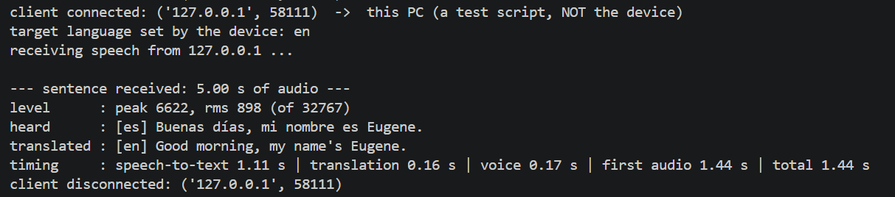
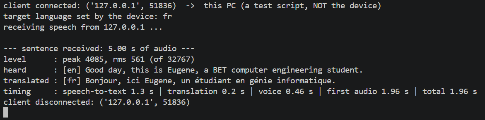
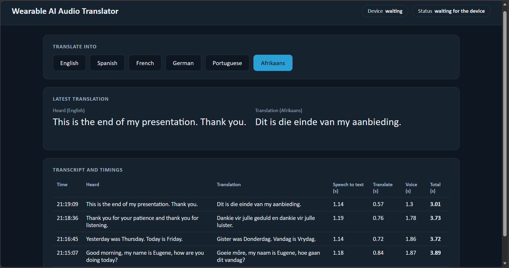
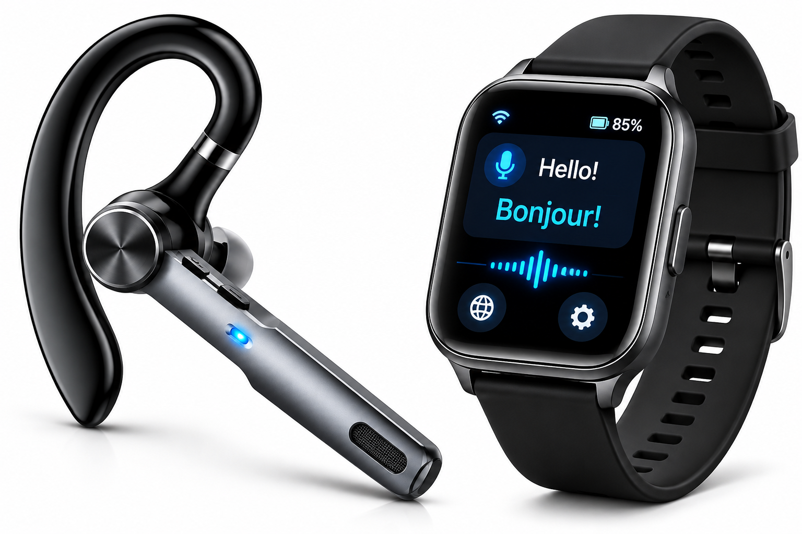

# Distributed Wearable AI Audio Translator

A wearable device that translates speech in real time. You wear it, someone speaks, and you hear the translation in your ear. The wearable captures and plays audio; a separate server does the heavy AI work (speech recognition, translation and speech synthesis).

Built as a proof of concept for Industrial Computing Design Project 3 (DES371S) at the Cape Peninsula University of Technology.

## The Problem

Language barriers can make everyday communication difficult, particularly in multicultural environments such as university campuses or day-to-day interactions with people from different cultures.

Although translation applications provide a way to overcome these barriers, they often interrupt conversations by requiring users to interact with a separate device. This creates a less natural communication experience, especially when people need to communicate regularly or in real time.

## The Solution

The **Wearable AI Audio Translator** explores a more natural way to communicate across languages through a wearable audio translation system.

The device captures spoken language, processes the audio, sends it to a translation server and plays the translated speech back to the user with minimal delay. By keeping the processing and response time short, the system aims to simulate a natural, real-time conversation across different languages.

It combines embedded systems, digital signal processing, wireless communication and AI-powered speech technologies in one integrated solution.

## Key Features

- **Wearable audio translation:** Captures speech and delivers translated audio through the wearable device, reducing the need to interact with a phone during conversations.
- **Two-way translation:** Supports communication in both directions between English and selected languages, subject to speech-recognition support.
- **Multiple languages:** Supports English, Spanish, French, German and Portuguese for the main speech-translation workflow. Afrikaans translation and speech output are also supported, but spoken Afrikaans input is not currently supported by the speech-recognition pipeline.
- **Speech processing:** Uses digital signal processing techniques to improve captured audio before speech recognition.
- **AI-powered speech processing:** Integrates speech recognition, language translation and text-to-speech technologies.
- **Translation dashboard:** Displays original and translated text, allowing users to review conversations and refer back to translated speech.
- **Expandable architecture:** Designed to allow additional languages and future hardware improvements.

The project aims to make multilingual communication more accessible through a practical combination of wearable hardware and intelligent audio processing.

## Project Gallery

The following images show the working prototype, system monitoring interface, user dashboard and proposed future product design.

### 1. Physical prototype

The prototype used for the university project presentation, demonstrating audio capture, processing and audio output.


### 2. System monitoring

The monitoring interface displays the captured speech and its translated audio/text results.





### 3. User dashboard

The dashboard provides a user-friendly view of the original speech and translated text, allowing users to review translations.



### 4. Proposed future device design

A proposed design showing how the wearable product could look in a future version. This is a design concept and not the physical prototype used for testing.



## How It Works

The system uses a **distributed architecture**: a small wearable cannot efficiently run large AI models, so it handles the lighter real-time tasks while a separate server performs the more computationally intensive processing.

```text
             WEARABLE (ESP32)                         SERVER (PC, later a Raspberry Pi)
+-------------------------------------+              +-----------------------------------+
| INMP441 microphone                  |              |                                   |
|   -> high-pass filter               |  Wi-Fi (TCP) | Whisper: speech to text           |
|   -> voice activity detection       | -----------> |   -> Argos / NLLB: translation    |
|   -> 20 ms audio frames             |              |   -> Piper / Simba: text to speech|
|                                     |              |                                   |
| MAX98357A amplifier -> speaker      | <----------- | Dashboard (localhost:8080)        |
+-------------------------------------+ translated   +-----------------------------------+
                                         audio
```

1. The user presses the session button and speaks.
2. The ESP32 reads the microphone over I2S, filters the audio and detects speech.
3. Speech is streamed to the server in 20 ms frames. A 0.6-second pause marks the end of a sentence.
4. The server converts the speech to text, translates it and turns the translation into speech.
5. The translated audio is streamed back and played through the amplifier and speaker.

## Repository Structure

```text
Wearable-AI-Audio-Translator/
│
├── README.md
├── .gitignore
│
├── firmware/
│   ├── README.md
│   └── ... ESP32 firmware source files
│
├── server/
│   ├── README.md
│   └── ... Python server and AI processing files
│
└── docs/
    ├── Prototype.png
    ├── System_Monitor_1.png
    ├── System_Monitor_2.png
    ├── User_Dashboard.png
    ├── Device_Design.png
```

Each main folder has its own README with additional details.

## Hardware

| Part | Purpose | Approx. cost |
|---|---|---:|
| ESP32 DevKit V1 | Microcontroller with Wi-Fi and two I2S interfaces | R150 |
| INMP441 | Digital I2S MEMS microphone | R68 |
| MAX98357A | I2S amplifier with built-in DAC (Class D) | R115 |
| 8 ohm speaker | Audio output | R40 |
| Stripboard, wires, solder | Hand-soldered circuit | R60 |
| Session and language push buttons | Start/stop listening and choose the language | - |

Wiring details are available in [firmware/README.md](firmware/README.md). KiCad was used for the schematic and PCB layout.

## Quick Start

### 1. Server

Run the server on a PC connected to the same Wi-Fi network as the wearable device.

From the `server` folder:

```bash
pip install -r requirements.txt
python setup_languages.py
python server.py
```

To test the server without the hardware:

```bash
python send_test_audio.py test_speech.wav es
```

### 2. Firmware

From the `firmware` folder, copy:

```text
main/wifi_secrets.example.h
```

to:

```text
main/wifi_secrets.h
```

Fill in your Wi-Fi details and the server's IP address. Then build and flash the firmware:

```bash
idf.py build
idf.py -p COM3 flash monitor
```

Replace `COM3` with the serial port assigned to your ESP32.

### 3. Using the Device

After the start-up beep, press the language button until you hear the number of beeps for your selected language:

- 1 beep: English
- 2 beeps: Spanish
- 3 beeps: French
- 4 beeps: German
- 5 beeps: Portuguese
- 6 beeps: Afrikaans

Press the session button and speak.

Note: Selecting Afrikaans does not mean that spoken Afrikaans input is fully supported. Afrikaans translation and speech output are available, but Afrikaans speech recognition remains a limitation.

## Results


Across 68 translated sentences on the development PC, the median processing time from receiving a sentence to the first translated audio was approximately 1.9 seconds, and 78% started within the 3-second target.

Speech-to-text processing is the slowest step. These measurements represent server-side processing time, not complete end-to-end device latency.

Further details are available in [server/README.md](server/README.md).

## Problems Encountered and Solutions

| Problem | Solution |
|---|---|
| The first microphone, an analogue MAX4466 module, produced no usable signal | Switched to the INMP441 digital microphone, which sends digital audio to the ESP32 over I2S |
| The LM386 analogue amplifier would need a separate DAC to play digital audio | Used the MAX98357A, which combines the DAC and amplifier in one chip |
| The ESP32-S3 was not available | Used the ESP32 DevKit V1, which has the I2S, Wi-Fi and processing capabilities needed |
| A PCB could not be manufactured through the university | Built the circuit on hand-soldered stripboard |
| Faulty solder joints stopped microphone data from arriving | Checked each connection and re-soldered the faulty joints |
| No 3D printer was available for the enclosure | Designed the enclosure in 3D and built a prototype housing from recycled material |
| The device translated its own voice from the speaker | The microphone is ignored for 0.6 seconds after playback |
| Small audio frames were delayed by TCP | Disabled Nagle's algorithm and sent each frame in one write |
| Phone-hotspot Wi-Fi drops | The firmware reconnects automatically and records the recovery time |
| Whisper detects Afrikaans as Dutch | The server uses a Dutch-to-Afrikaans handling workaround; this does not provide reliable Afrikaans speech recognition |
| Argos and Piper do not support Afrikaans, and the standard MMS voice used in the initial implementation did not provide the required Afrikaans output | Used NLLB-200 for Afrikaans text translation and the Simba-TTS Afrikaans voice from UBC-NLP for speech output |

## Limitations

- **South African languages:** Afrikaans translation and speech output are supported, but spoken Afrikaans input is not currently supported by the speech-recognition pipeline. IsiXhosa and isiZulu are not supported in the current implementation. Additional African-language models and speech data are needed to expand language support.
- **Server hardware:** The server currently runs on a PC. A Raspberry Pi would need sufficient memory and processing capacity to run the selected models. A Raspberry Pi Zero 2 W is not sufficient for the complete setup.
- **Power:** The prototype is powered over USB; battery power is future work.
- **Security:** The Wi-Fi connection between the wearable and server is not encrypted.
- **Tuning:** Voice-detection thresholds have not been tuned across many noise conditions, and language detection on very short phrases can be incorrect.
- **Model licences:** NLLB-200 is licensed under CC BY-NC 4.0, which restricts use to non-commercial purposes and requires attribution. Commercial use requires separate permission.

## Third-Party Models and Acknowledgements

This project uses third-party speech and translation models. Their licences are separate from the licence of the project's own source code.

- **Meta NLLB-200:** Used for text translation, including Afrikaans. Licensed under [Creative Commons Attribution-NonCommercial 4.0 International (CC BY-NC 4.0)](https://creativecommons.org/licenses/by-nc/4.0/). See the [NLLB-200 model information](https://huggingface.co/facebook/nllb-200-3.3B).
- **UBC-NLP Simba-TTS-afr:** Used for Afrikaans text-to-speech. The model card identifies its licence as [Creative Commons Attribution 4.0 International (CC BY 4.0)](https://creativecommons.org/licenses/by/4.0/). See the [Simba-TTS-afr model card](https://huggingface.co/UBC-NLP/Simba-TTS-afr).
- **Other models and libraries:** Whisper, Argos Translate, Piper and other project dependencies are subject to their respective licences. Refer to their official documentation and repositories for details.

The downloaded model weights are not included in this repository. They are obtained separately through the server setup process.

## Future Work

- Manufacture the PCB and 3D-print the enclosure.
- Add a LiPo battery and charging circuit.
- Move the server to a Raspberry Pi 4 or 5.
- Gather more data on South African languages and add them to the system.
- Improve Afrikaans speech recognition and expand support for other South African languages.
- Connect the separate web dashboard ([Wearable Translator Dashboard](https://iottranslater.netlify.app/translate)) to the device.